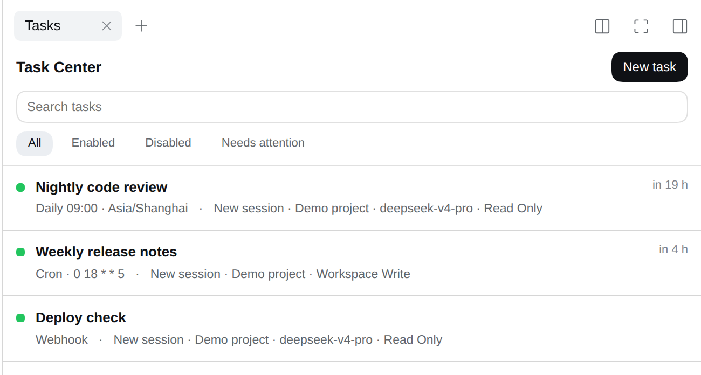
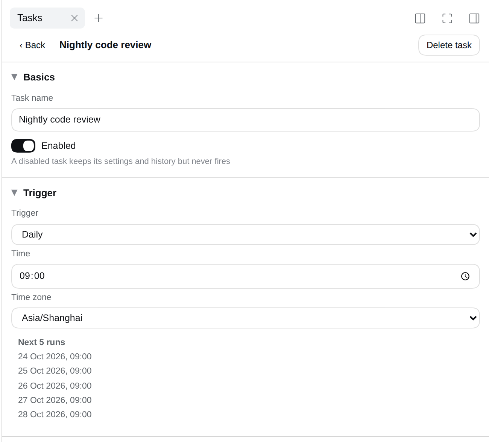
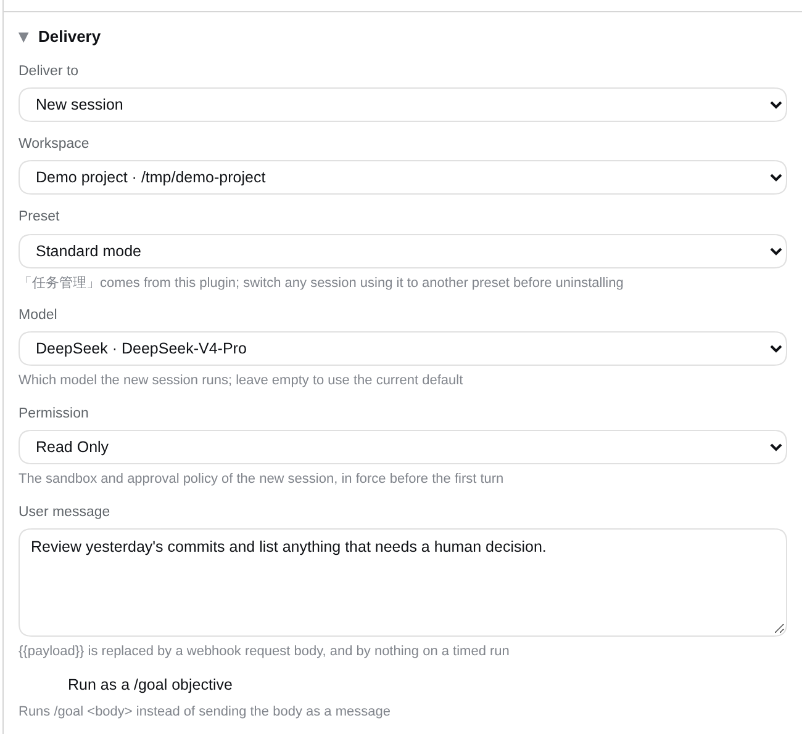
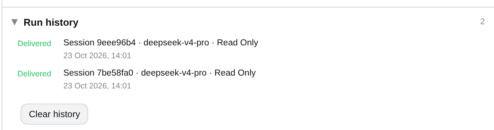

# Task Center for DSH

**任务中心 / Task Center** — scheduled and webhook-triggered tasks for DeepSeek Harness.
Add a task once, and DSH opens a session or messages an existing one on your schedule.

<p align="center">
  
</p>

<p align="center">
  <a href="https://www.npmjs.com/package/@ds-hu/dsh-auto-task-center"></a>
  <a href="LICENSE"></a>
  <a href="README.zh-CN.md">中文</a>
</p>

---

## A tab, right where you work

Task Center is a tab in the session's right sidebar: no new window, no separate app.
Every row answers three questions at a glance — is it on, when does it fire next, where does it deliver.
A disabled task stays in the list with its settings and history intact.

## Six triggers, and you can see the clock

One-off, interval, daily, weekly, cron, or a webhook URL — pick the simplest form that fits.
**Next 5 runs** is computed in the time zone you chose, so a wrong cron expression shows up before you save it.

<p align="center">
  
</p>

## Where it runs, on which model, with which permission

Deliver into a **brand-new session** or into an **existing conversation**. For a new session the task decides:

- the **workspace** and the **agent preset**;
- the **model** — the cheap one for routine digests, the deep one for real reasoning;
- the **permission** — read only, workspace write, or full access, the same presets DSH itself offers.
  It is in force before the first turn, so a nightly job is boxed in from its very first action.

<p align="center">
  
</p>

The message is yours to write and arrives as a normal user message, so slash commands still work:
`/goal` turns the trigger into an autonomous goal run, and any `/skill-name` loads that skill.

The model and permission pickers appear only when the Host offers them, and leaving either empty follows the
deployment default. If a model or preset later disappears, the task is never silently re-pointed at something
else: the run record says what failed instead of delivering into the wrong sandbox.

With [`dsh-better-workspaces`](https://github.com/ds-hu/dsh-better-workspaces) installed, a new session can also
land in a **fresh worktree made per run**: each run branches off the base you pick, so a nightly job never touches
the checkout you have open.

## Webhooks and the run record

Every webhook task gets its own URL and secret — paste it into GitHub, your CI, or a shell one-liner; it shares
DSH's port. The request body replaces `{{payload}}` in your message, and **Rotate secret** makes a leaked URL
useless in one click.

```bash
curl -X POST "http://127.0.0.1:3080/task-center/hook/<task-id>/<secret>" -d '{"branch":"main"}'
```

Every run leaves a record: delivered, skipped because DSH was closed, or failed because the target was gone.
A task that keeps failing is flagged **needs attention** instead of quietly doing nothing.

<p align="center">
  
</p>

## A preset that hands scheduling to the agent

Installing the plugin adds an agent preset, **任务管理**: Standard mode without the built-in reminder tools, plus a
`task_center` tool — so you can say *"every weekday at 9, summarise the repo"* and the agent writes the task itself.

The panel borrows DSH's theme tokens, so it looks native in light and dark alike.

---

## Install

```bash
dsh plugin --profile web add @ds-hu/dsh-auto-task-center
```

Restart `dsh web`, open any session, and pick **Task Center** from the right sidebar's start page.
The **任务管理** preset shows up in the composer's mode menu.

## Uninstall

The plugin writes only under `$DSH_HOME/task-center/` and registers no install scripts, so removing it leaves no
services, no timers and no patched configuration behind.

```bash
dsh plugin --profile web remove @ds-hu/dsh-auto-task-center
dsh-auto-task-center purge --yes   # optional: also delete the stored tasks
```

Move sessions off the **任务管理** preset first, then click away the one dead tab DSH keeps in your browser.
Details in [Uninstall](docs/TECHNICAL.md#uninstall).

## Documentation

| Document | What is in it |
|---|---|
| [docs/TECHNICAL.md](docs/TECHNICAL.md) | Architecture, data model, HTTP API, scheduling rules, uninstall |
| [CONTEXT.md](CONTEXT.md) | The vocabulary this plugin is built on |
| [docs/adr](docs/adr) | Why the design is what it is |

## License

MIT. See [LICENSE](LICENSE).
