# Task Center for DSH

**任务中心 / Task Center** — scheduled and webhook-triggered tasks for DeepSeek Harness.
Add a task once, and DSH opens a session or messages an existing one on your schedule.

<p align="center">
  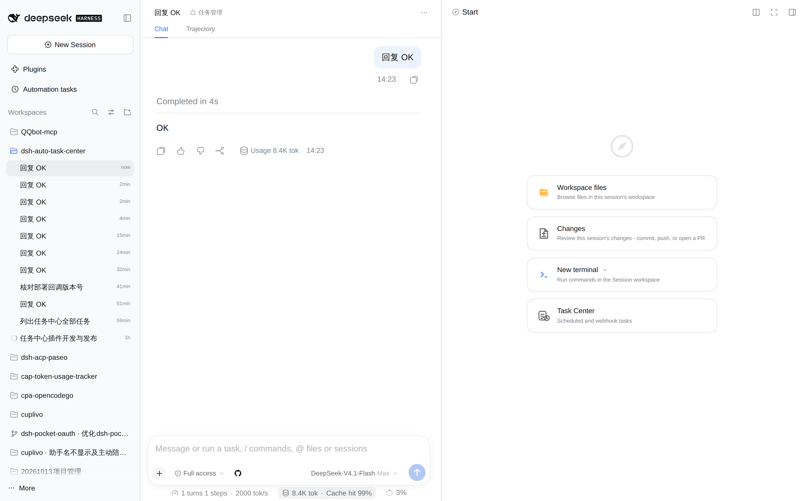
</p>

<p align="center">
  <a href="https://www.npmjs.com/package/@ds-hu/dsh-auto-task-center"></a>
  <a href="LICENSE"></a>
  <a href="README.zh-CN.md">中文</a>
</p>

---

## A tab, right where you work

Task Center lives in the session's right sidebar. No new window, no separate app: open the tab, and it stays next to the conversation it belongs to.

<p align="center">
  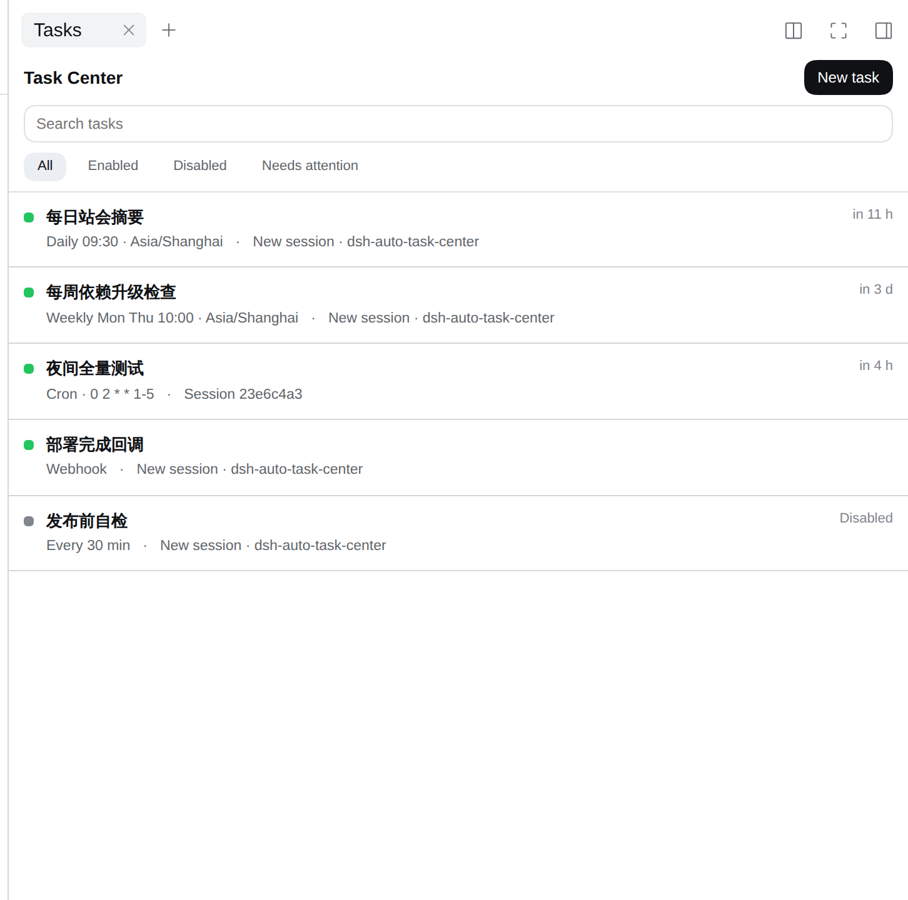
</p>

Every row answers three questions at a glance: is it on, when does it fire next, and where does it deliver.
Disabled tasks stay in the list, greyed out, keeping their settings and history.

## Six ways to trigger a task

Pick the simplest form that fits — one-off, interval, daily, weekly, cron, or a webhook URL.

<p align="center">
  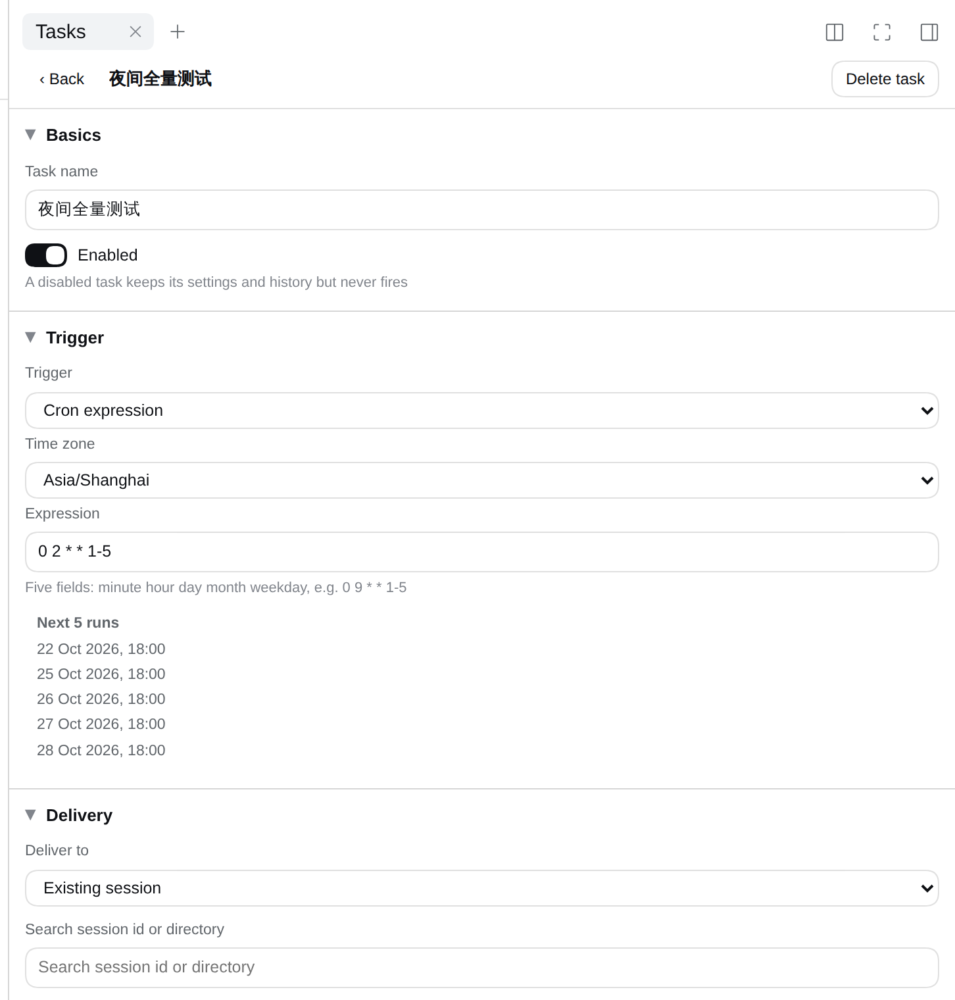
</p>

Nothing is a black box: **Next 5 runs** shows exactly when the task will fire in the time zone you picked,
so a wrong cron expression is visible before you save it.

<p align="center">
  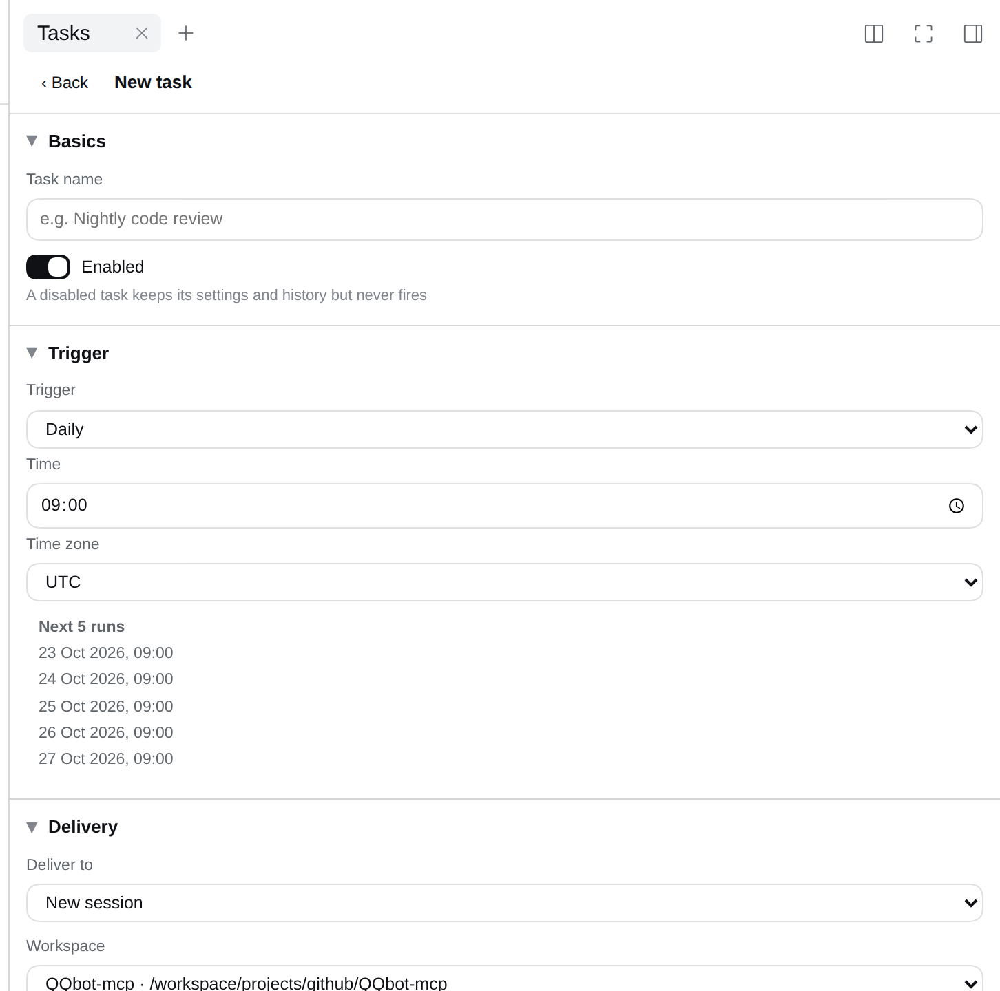
</p>

## Deliver where the work happens

Send it into a **brand-new session** in the workspace you choose, with the agent preset you choose,
or into an **existing conversation**.

<p align="center">
  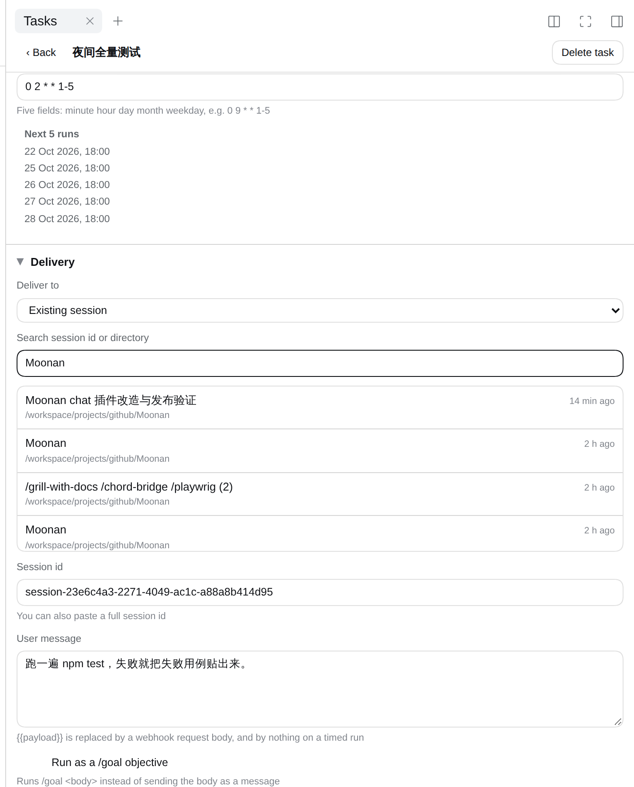
</p>

The message is yours to write. Slash commands work in it, because DSH receives it as a normal user message:
`/goal` turns the task into an autonomous goal run, and any `/skill-name` loads that skill.

### Run it in a fresh worktree

With [`dsh-better-workspaces`](https://www.npmjs.com/package/dsh-better-workspaces) installed, a task can
deliver into a **fresh worktree** instead of the workspace itself: every run branches off the base you pick
and works in its own directory, so a nightly job never touches the checkout you have open.

<p align="center">
  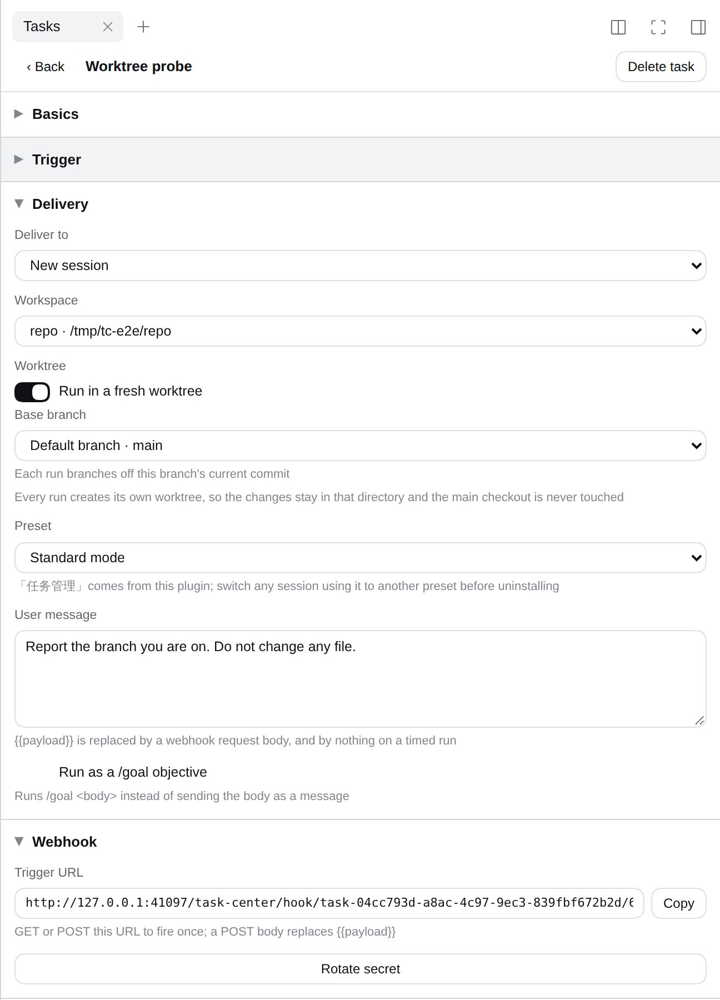
</p>

Two runs, two branches. The history says where each run worked:

<p align="center">
  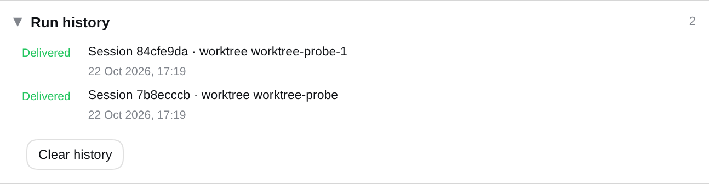
</p>

Without that plugin the option simply isn't offered, and every other target works as before. A task that
already asked for a worktree keeps its switch and explains itself, so pointing it back at the workspace is
one click instead of a hunt for what broke.

## Webhooks, on the same port

Every webhook task gets a URL with its own secret — copy it into GitHub, your CI, or a shell one-liner.

<p align="center">
  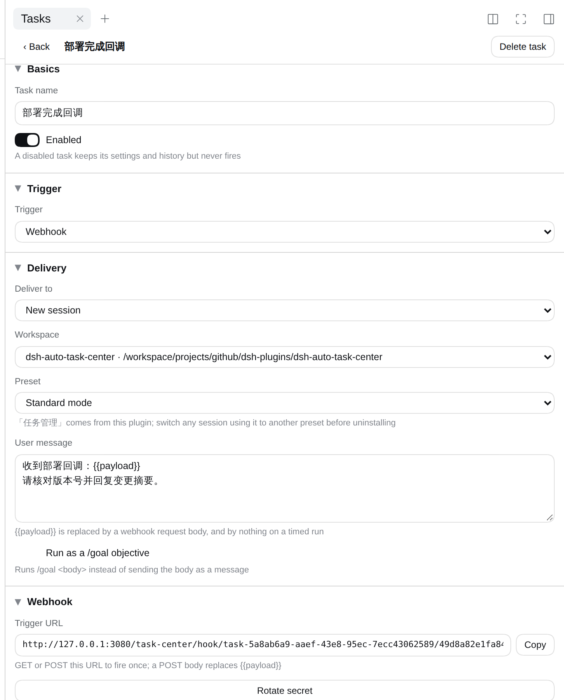
</p>

The request body replaces `{{payload}}` in your message. A leaked URL is one click from being useless:
**Rotate secret** issues a new one and the old URL stops working immediately.

## A history you can act on

<p align="center">
  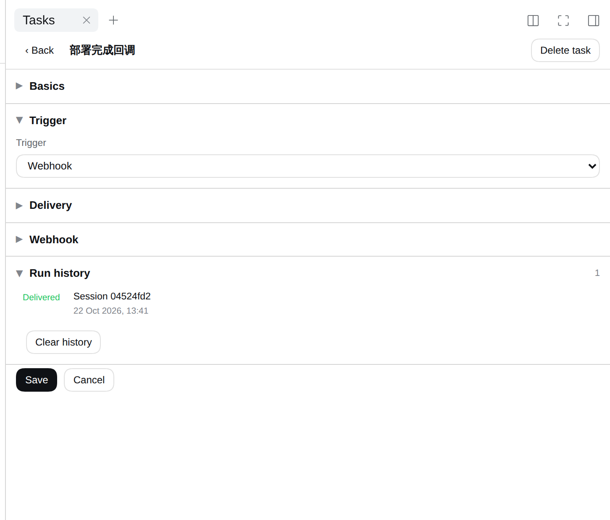
</p>

Every run is recorded — delivered, skipped while DSH was closed, or failed because the target disappeared.
A task that keeps failing is flagged **needs attention** instead of silently doing nothing.

## It follows your theme

<p align="center">
  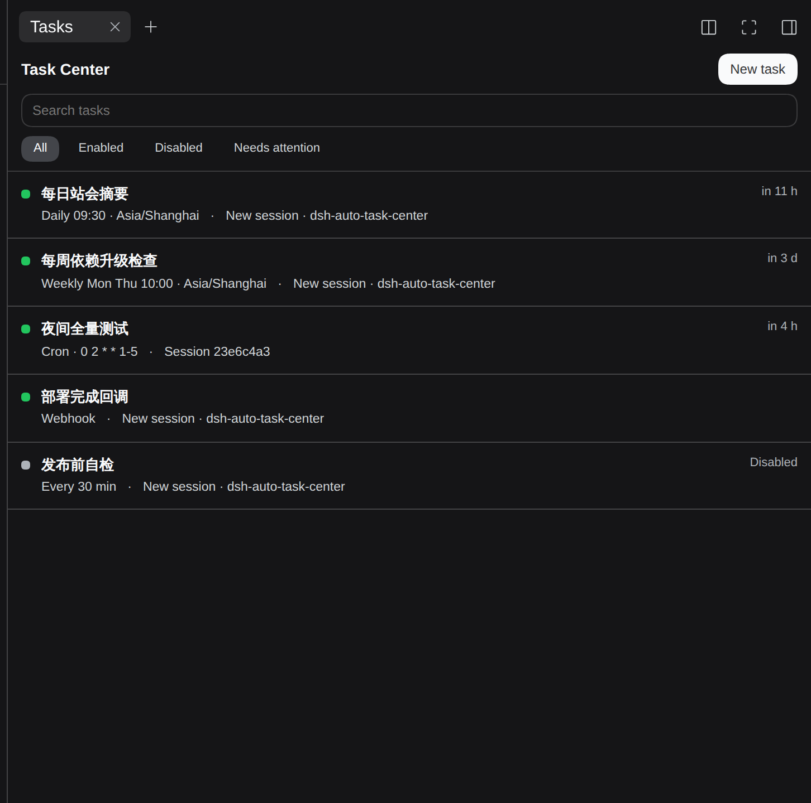
</p>

Light and dark come from DSH's own theme tokens, so the panel looks like part of the app in either mode.

## A preset that hands scheduling to the agent

<p align="center">
  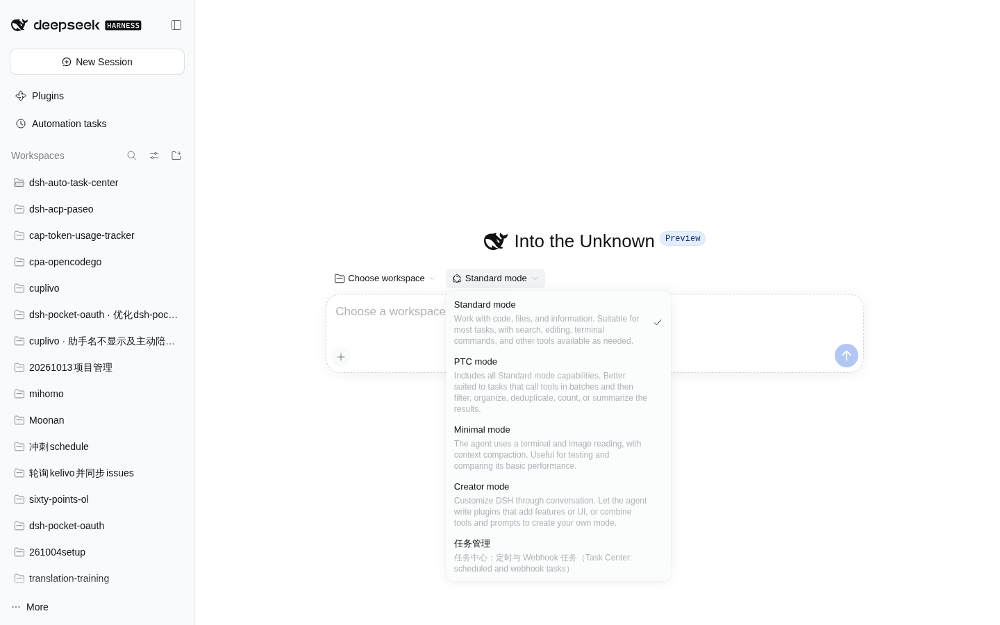
</p>

Install the plugin and a new agent preset appears: **任务管理**. It is Standard mode without the built-in
reminder tools, plus a `task_center` tool — so you can say *"every weekday at 9, summarise the repo"* and
the agent writes the task itself.

---

## Install

```bash
dsh plugin --profile web add @ds-hu/dsh-auto-task-center
```

Restart `dsh web`, open any session, and pick **Task Center** from the right sidebar's start page.
The **任务管理** preset shows up in the composer's mode menu.

Fresh worktrees are the one optional extra: install
[`dsh-better-workspaces`](https://www.npmjs.com/package/dsh-better-workspaces) in the same profile and the
delivery section grows a worktree switch. Nothing else changes if you don't.

## Uninstall

Remove the plugin the same way you added it. It writes nothing outside `$DSH_HOME/task-center/`, and it
registers no install scripts, so removing it leaves no services, no cron entries and no patched config.

```bash
dsh plugin --profile web remove @ds-hu/dsh-auto-task-center
dsh-auto-task-center purge --yes   # optional: also delete the stored tasks
```

Two things to know before you remove it — see [Uninstall](docs/TECHNICAL.md#uninstall) for the details:
move sessions off the **任务管理** preset first, and click away the one dead tab DSH keeps in your browser.

## Documentation

| Document | What is in it |
|---|---|
| [docs/TECHNICAL.md](docs/TECHNICAL.md) | Architecture, data model, HTTP API, scheduling rules, uninstall |
| [CONTEXT.md](CONTEXT.md) | The vocabulary this plugin is built on |
| [docs/adr](docs/adr) | Why the design is what it is |

## License

MIT. See [LICENSE](LICENSE).
